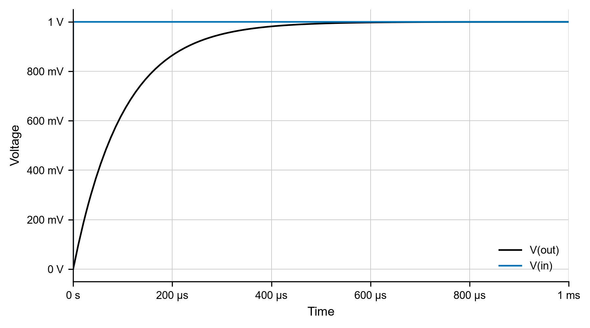

# RC Low-Pass Filter Step Response

*Double Secret Labs · sample report*

## Summary

A first-order RC low-pass filter ($R = 1\,\text{k}\Omega$, $C = 100\,\text{nF}$) was simulated in
LTspice with a 1 V step input. The 10 %–90 % rise time is $220\,\mu\text{s}$, matching the
analytic value $2.2\,RC$.

## Method

Circuit and analysis: `rc_lowpass.cir` (`.tran 0 5m 0 5u`). Signals: `V(in)`, `V(out)`.
Figure generated by `make_figures.py`.

The filter time constant and cutoff frequency are

$$\tau = RC = 100\,\mu\text{s}, \qquad f_c = \frac{1}{2\pi RC} = 1.59\,\text{kHz}.$$

## Results

**Figure 1:** RC low-pass step response (1 V step, $R = 1\,\text{k}\Omega$, $C = 100\,\text{nF}$).

| Quantity | Simulated | Analytic |
|---|---|---|
| Final value | 1.000 V | 1 V |
| Rise time (10 %–90 %) | 220 µs | $2.2\,RC = 220\,\mu\text{s}$ |

## Conclusions

The simulation agrees with the first-order analytic model.
